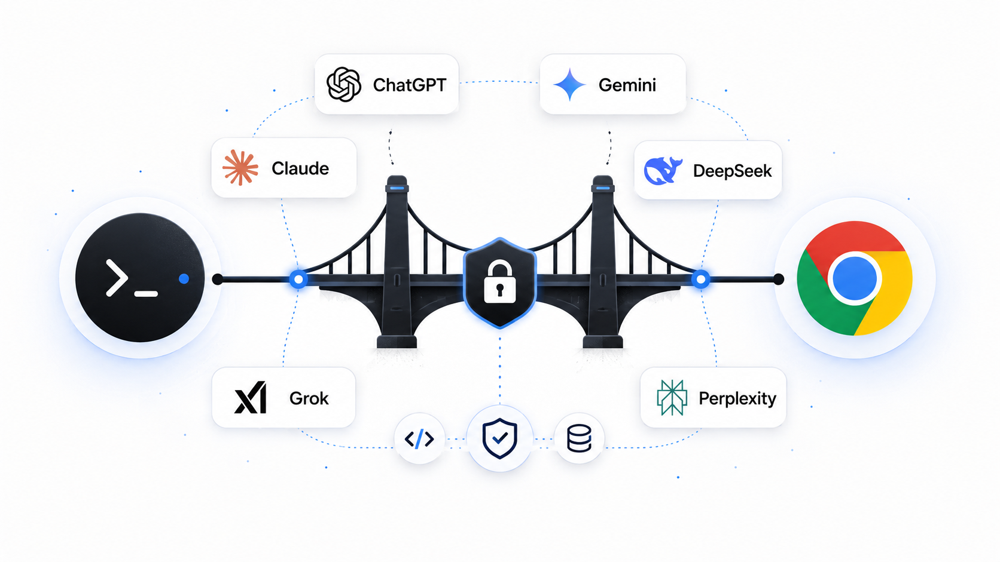

<p align="center">
  
</p>

# ai-browser-bridge

[English](README.md) · [עברית](README.he.md) · **Español** · [中文](README.zh.md)


---

> Controla conversaciones reales de ChatGPT o Gemini desde tu terminal y ofrece a ChatGPT un conjunto reducido de herramientas locales del repositorio vía MCP — sin entregarle nunca una shell.

## Por qué existe

ChatGPT rinde mejor en el navegador: el estado real de la cuenta, el selector de modelos, la edición de mensajes, la regeneración y el historial de conversación se mantienen intactos. Programar rinde mejor en la terminal, donde archivos, pruebas, diffs y parches se inspeccionan y modifican directamente.

`ai-browser-bridge` conecta esas dos superficies. Un prompt en la terminal controla tu sesión existente del proveedor en el navegador, y ChatGPT puede acceder al repositorio actual mediante un pequeño conjunto de **herramientas MCP validadas** — `grep`, `read`, `apply_patch`, `run_tests`, `git_diff` — en lugar de acceso directo a la shell. Tú permaneces en un único flujo de terminal; el proveedor conserva su interfaz real.

## Características

- **Diez proveedores, un comando** — ChatGPT, Gemini, Claude, DeepSeek, Grok, Perplexity, Duck.ai, Arena, Google Flow y Claude Design. Selecciona uno con `--provider` o consulta varios en paralelo.
- **Diseñado para agentes** — `bridge ask … --json` ofrece una interfaz no interactiva estable, y `bridge serve` expone herramientas MCP salientes.
- **Herramientas locales en sandbox vía MCP** — cada operación de archivo se valida contra la raíz del repositorio seleccionado; sin shell arbitraria, solo comandos de prueba en lista blanca.
- **Sesiones, transcripciones y descargas en la raíz del repositorio** — las ejecuciones persistentes usan siempre `<repo>/.bridge/`, incluso cuando se inician desde un subdirectorio.
- **Controles de seguridad** — modos de permiso (`read-only` / `ask` / `auto`) y checkpoints automáticos de archivos alrededor de cada parche.


Comandos CLI y herramientas MCP para que los agentes de código controlen servicios de IA en tu navegador autenticado. `bridge` sin subcomando muestra la ayuda.

Se eliminaron la interfaz de conversación interactiva y sus comandos de barra. Los archivos de comandos personalizados ya no se leen; tus perfiles y archivos existentes se conservan.

## Arquitectura

`browserMcp` ofrece operaciones del navegador a agentes de código mediante `bridge serve`. `repoMcp` ofrece herramientas del repositorio en sandbox a conectores del navegador por HTTP y un túnel. `webProviders` contiene los adaptadores, `repoState` el estado persistente y `hooks` los archivos de hooks. `src/config.ts` define los proveedores y valores predeterminados. [Estructura completa](README.md#project-structure).

## Inicio rápido

**Requisitos previos**

- **macOS** — Chrome se inicia mediante `open`; la gestión de procesos usa `lsof`.
- **Node.js ≥ 22** y **pnpm** (el repo fija `pnpm@10.14.0`).
- **Google Chrome o Chrome for Testing** — el bridge reutiliza un perfil global compartido en `~/.ai-browser-bridge/chrome-profile`.
- **`cloudflared`** *(opcional)* — necesario para que ChatGPT, Claude o Grok llamen a herramientas locales. Los comandos normales del navegador funcionan sin él. Instala con `brew install cloudflared`.

**Instalar y construir**

```bash
git clone https://github.com/YosefHayim/ai-browser-bridge.git
cd ai-browser-bridge
pnpm install
pnpm build
```

**Inicia Chrome una vez y luego ejecuta**

```bash
# Abre el perfil compartido de Chrome del bridge; inicia sesión si hace falta
node dist/bridge.js chrome start

# Envía una petición para el repositorio seleccionado
node dist/bridge.js ask "Explica @README.md" --repo /path/to/your/project --json
```

¿Prefieres un comando `bridge` global? Ejecuta `pnpm link --global` tras construir, y usa `bridge`, `bridge chrome start`, `bridge ask "…"`, etc.

## Agentes y proveedores

`bridge ask` puede consultar un proveedor o distribuir la misma pregunta entre varios. Las respuestas se devuelven por proveedor y los fallos parciales no descartan los resultados correctos.

```bash
bridge ask --provider claude --json "resume este repositorio"
bridge ask --provider claude,deepseek,grok --json "compara estos enfoques"
bridge serve
```

`bridge serve` ofrece `ask` y `search_conversations` por MCP stdio. ChatGPT, Claude y Grok pueden usar el conector MCP entrante; Gemini, DeepSeek, Perplexity, Duck.ai y Arena funcionan como chats web, y Flow funciona como superficie de generación de vídeo.

## Dónde se guarda el estado

Todo el estado del bridge para un proyecto se escribe bajo `<repo>/.bridge/` en la raíz canónica del árbol de trabajo Git. Iniciar el bridge desde un subdirectorio sigue usando esa única raíz; un directorio explícito que no pertenece a Git sigue siendo su propia raíz. El bridge no crea ni administra `.bridge/.gitignore`; esa política pertenece al repositorio de destino.

> Los hooks de usuario se guardan en `~/.ai-browser-bridge/hooks.json`. Su ejecución sigue deshabilitada.

## Permisos y checkpoints

Configura `permissionMode` en `.bridge/config.json` del repositorio de destino, conservando los demás campos. `read-only` permite lectura; `auto` también permite las herramientas acotadas de escritura y pruebas; `ask` bloquea operaciones que requieren confirmación. El valor predeterminado es `auto`; no hay confirmación interactiva.

`apply_patch` conserva instantáneas en `.bridge/checkpoints/`. Tras eliminar la interfaz interactiva, no hay un comando CLI de restauración.

## Pruebas

```bash
pnpm test          # vitest run
pnpm typecheck     # tsc --noEmit
pnpm verify:push   # Biome + typecheck + tests + build + controles estructurales
```

La cobertura se centra en las rutas sensibles a la seguridad — validación de sandbox, resolución de la raíz canónica del repositorio, los almacenes de sesiones/checkpoints, permisos y conteo de contexto.

## Soporte de Google Flow

El bridge también puede controlar **[Google Labs Flow](https://labs.google/fx/tools/flow)** — el estudio de vídeo con IA de Google impulsado por Veo — con el mismo patrón Playwright/CDP. Flow es distinto en esencia a los proveedores de chat: es una superficie de **generación**, así que una «respuesta» es un **clip** renderizado y los adjuntos son **ingredientes** (imágenes de referencia).

```bash
bridge chrome start --provider flow    # inicia sesión en Google; la cuenta necesita acceso a Flow (AI Pro/Ultra)
bridge ask --provider flow "a cat surfing a neon wave, cinematic, 8s"
bridge ask --provider flow "same scene, dawn light" --attach ref1.png ref2.png   # hasta 3 ingredientes
```

Más allá de generar, el bridge controla el **ciclo de vida de recursos** completo de Flow mediante los subcomandos `bridge flow` (cada uno se conecta a la pestaña de tu proyecto de Flow actual; añade `--json` para una salida legible por máquina):

```bash
bridge flow clips                        # lista los clips del proyecto actual (id + URL descargable)
bridge flow download                     # descarga los mp4 en <repo>/.bridge/downloads/flow
bridge flow reuse   --id <clipId>        # vuelve a añadir un clip al prompt como entrada ("Add to prompt")
bridge flow extend  --id <clipId>        # añade un clip a una escena ("Add to scene" de Flow)
bridge flow rename  --id <clipId> --name "hero shot"
bridge flow delete  --id <clipId> --yes  # mueve un clip a la Papelera de Flow (recuperable)
bridge flow ingredients                  # lista las imágenes de referencia adjuntas al prompt
bridge flow ingredient-remove --id <mediaId>   # desvincula un ingrediente
bridge flow ingredient-clear             # desvincula todos los ingredientes
bridge flow projects                     # lista los proyectos
bridge flow project-rename --name "Launch teaser"
bridge flow project-delete --yes         # elimina permanentemente el proyecto actual
```

Los verbos destructivos (`delete`, `project-delete`) requieren `--yes`; borrar un clip lo mueve a la Papelera recuperable de Flow.

Los agentes sin acceso a shell obtienen el mismo ciclo de vida como **herramientas MCP `flow_*`** vía `bridge serve` — `flow_list_clips`, `flow_download_clips`, `flow_reuse_clip`, `flow_extend_clip`, `flow_rename_clip`, `flow_delete_clip`, `flow_list_ingredients`, `flow_remove_ingredient`, `flow_clear_ingredients`, `flow_list_projects`, `flow_rename_project`, `flow_delete_project`. Las herramientas destructivas (`flow_delete_clip`, `flow_delete_project`) requieren `confirm: true`.

**Qué funciona en Flow**

- Prompts de tomas desde la terminal que disparan la generación de Veo
- **Ingredientes** — adjunta hasta tres imágenes de referencia a un prompt, y lista / quita / limpia las que ya están adjuntas
- Una **referencia de clip** capturada (el `src` del vídeo / el href de descarga) devuelta como respuesta, de modo que un agente obtiene un puntero al resultado
- **CRUD de recursos** — lista / descarga / renombra / elimina clips, extiende o reutiliza un clip, gestiona los ingredientes del prompt, y lista / renombra / elimina proyectos — como comandos CLI `bridge flow …` **y** herramientas MCP `flow_*` vía `bridge serve`
- Reutiliza el mismo modelo de perfil compartido del bridge / puerto de depuración que todos los proveedores

**Qué no funciona en Flow (hoy)**

- **Conector MCP**, — Flow no tiene interfaz de conector, así que el servidor MCP y el túnel de Cloudflare se omiten (igual que Gemini).
- **Controles de parada / a mitad de render** — cancelar un render de Veo en curso todavía no está implementado.

Flow requiere un plan **Google AI Pro/Ultra**. Como los renders de Veo tardan minutos, `--provider flow` espera una respuesta mucho más tiempo que los proveedores de chat.

**Mantenimiento de selectores:** si cambia la interfaz de Flow, inspecciona el editor con la sesión iniciada y actualiza los selectores en `src/config.ts` y el adaptador en `src/features/webProviders/flow/flowPage.ts`.

## Soporte de Claude Design

El bridge controla **[Claude Design](https://claude.ai/design)** desde tu Chrome del bridge con sesión iniciada. Las lecturas y los cambios de proyectos/archivos usan las propias peticiones de la app desde la pestaña; los turnos, plantillas y modelo/esfuerzo pasan por la interfaz real, una pestaña por proyecto.

```bash
bridge chrome start --provider design
bridge design catalog                   # plantillas, modelos + esfuerzo, sistemas de diseño
bridge design projects
bridge design model --model "Sonnet 4.6" --effort Low   # modelo (incl. More models) + esfuerzo
bridge design create --template Slides --prompt "lanzamiento Q3" --model "Haiku 4.5" --effort Low
bridge design send --project <id> --message "título más grande"
bridge design read --project <id>       # Conversaciones y últimos mensajes
bridge design files --project <id>
bridge design put --project <id> --file hero.png
bridge design rm --project <id> --path hero.png --yes
bridge design download --project <id>
bridge design export --project <id>
bridge design share --project <id> --access workspace
bridge design state
```

Los agentes tienen lo mismo como herramientas MCP **`design_*`** en `bridge serve`; las destructivas requieren `confirm: true`. Publicar como artefacto, Claude Code, exportar PNG/vídeo/PDF/PowerPoint, comentarios y restaurar versiones quedan en la interfaz.

## Limitaciones

- **Solo macOS** por ahora (ruta de Chrome fija y ayudantes `lsof`).
- Los selectores de los proveedores pueden romperse cuando cambian sus interfaces web; los arreglos están localizados en sus adaptadores.
- El uso de contexto es una **estimación** — el navegador no expone el conteo exacto de tokens del servidor.
- El túnel de Cloudflare requiere `cloudflared` instalado.
- Local-first por diseño; no es un servicio multiusuario alojado.
- La ejecución de comandos de hooks se analiza y reporta pero aún no se ejecuta.

## Licencia

[MIT](LICENSE) © YosefHayim
