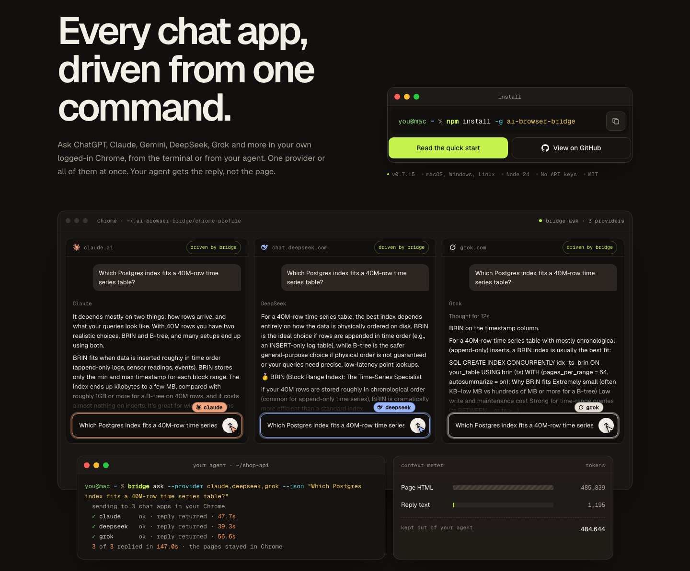

# ai-browser-bridge

**Every chat app, driven from one command.** ai-browser-bridge is a CLI and MCP server that drives ChatGPT, Claude, Gemini and more in your own logged-in Chrome, so a terminal or an agent gets the reply text back instead of the page. It needs no API keys.

Site and docs: https://yosefhayim.github.io/ai-browser-bridge/

[](https://yosefhayim.github.io/ai-browser-bridge/)

## Quick start

Needs macOS, Node.js 22 or newer, pnpm and Google Chrome. Details are in the [usage guide](https://yosefhayim.github.io/ai-browser-bridge/docs/usage/).

```bash
git clone https://github.com/YosefHayim/ai-browser-bridge.git
cd ai-browser-bridge
pnpm install
pnpm build
```

Start Chrome, then run (ChatGPT is the default):

```bash
node dist/bridge.js chrome start
node dist/bridge.js --repo /path/to/your/project
node dist/bridge.js ask "summarize @src/core/engine.ts" --repo /path/to/project
```

Or install the published CLI with `npm install -g ai-browser-bridge`, then use `bridge chrome start` and `bridge ask "..."`. Pick another chat app with `--provider`, or fan out with `--provider claude,deepseek,grok`.

## Providers

| Provider      | Host              | Page                                                                               |
| ------------- | ----------------- | ---------------------------------------------------------------------------------- |
| ChatGPT       | chatgpt.com       | [chatgpt](https://yosefhayim.github.io/ai-browser-bridge/providers/chatgpt/)       |
| Claude        | claude.ai         | [claude](https://yosefhayim.github.io/ai-browser-bridge/providers/claude/)         |
| Gemini        | gemini.google.com | [gemini](https://yosefhayim.github.io/ai-browser-bridge/providers/gemini/)         |
| DeepSeek      | chat.deepseek.com | [deepseek](https://yosefhayim.github.io/ai-browser-bridge/providers/deepseek/)     |
| Grok          | grok.com          | [grok](https://yosefhayim.github.io/ai-browser-bridge/providers/grok/)             |
| Perplexity    | perplexity.ai     | [perplexity](https://yosefhayim.github.io/ai-browser-bridge/providers/perplexity/) |
| Duck.ai       | duck.ai           | [duck](https://yosefhayim.github.io/ai-browser-bridge/providers/duck/)             |
| Arena         | arena.ai          | [arena](https://yosefhayim.github.io/ai-browser-bridge/providers/arena/)           |
| Google Flow   | labs.google       | [flow](https://yosefhayim.github.io/ai-browser-bridge/providers/flow/)             |
| Claude Design | claude.ai/design  | [design](https://yosefhayim.github.io/ai-browser-bridge/providers/design/)         |

## Links

- [Site](https://yosefhayim.github.io/ai-browser-bridge/)
- Docs: [overview](https://yosefhayim.github.io/ai-browser-bridge/docs/), [usage](https://yosefhayim.github.io/ai-browser-bridge/docs/usage/), [agents and fan-out](https://yosefhayim.github.io/ai-browser-bridge/docs/agents/), [where state lives](https://yosefhayim.github.io/ai-browser-bridge/docs/state/), [permissions and checkpoints](https://yosefhayim.github.io/ai-browser-bridge/docs/permissions/), [limitations](https://yosefhayim.github.io/ai-browser-bridge/docs/limitations/)
- [MCP tools](https://yosefhayim.github.io/ai-browser-bridge/#mcp)
- [CONTEXT.md](CONTEXT.md): how the code is laid out
- [AGENTS.md](AGENTS.md): commands, tests and release steps for contributors and agents

## License

[MIT](LICENSE) © YosefHayim
