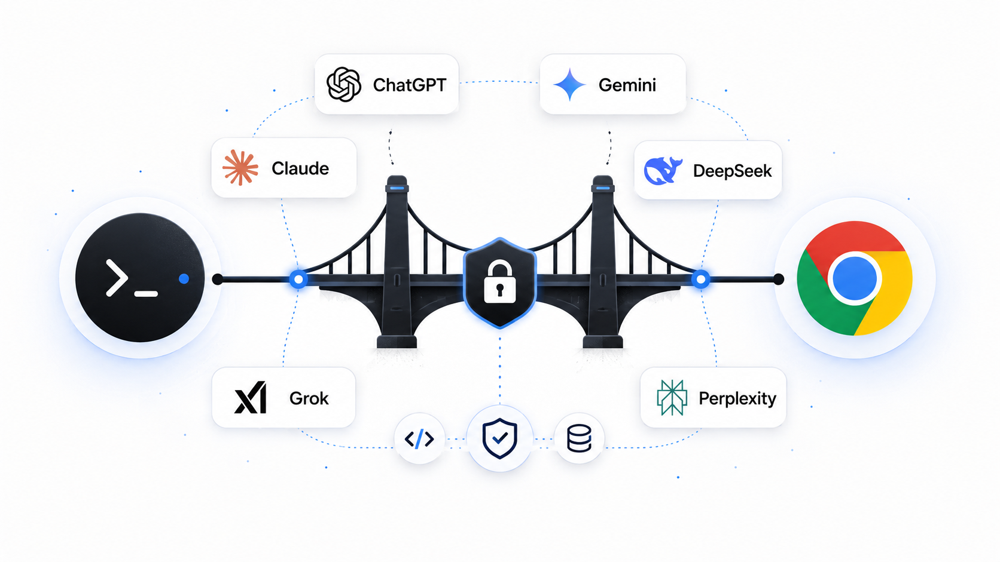

<p align="center">
  
</p>

# ai-browser-bridge

> Drive a real ChatGPT or Gemini browser conversation from your terminal, and give ChatGPT a narrow, sandboxed set of local repo tools over MCP — without ever handing it a shell.

**English** · [עברית](README.he.md) · [Español](README.es.md) · [中文](README.zh.md)


---

## Why this exists

ChatGPT is at its best in the browser — real account state, the model picker, message editing, regeneration, and conversation history all intact. Coding is at its best in the terminal, where files, tests, diffs, and patches are inspected and changed directly.

`ai-browser-bridge` connects those two surfaces. A terminal prompt drives your existing ChatGPT or Gemini browser session, and ChatGPT can reach into the current repo through a small set of **validated MCP tools** — `grep`, `read`, `apply_patch`, `run_tests`, `git_diff` — instead of raw shell access. You stay in one terminal workflow; the provider keeps its real UI.

## Features

- **CLI and MCP for coding agents** — send prompts with `bridge ask … --json`, or expose browser tools with `bridge serve`.
- **Browser services** — ChatGPT, Gemini, Claude, DeepSeek, Grok, Perplexity, Duck.ai, Arena, Flow, and Claude Design keep their real browser state. Use `--provider` to choose a service; supported conversation providers can run in a Fan-out.
- **Sandboxed repo tools** — browser connectors can read, patch, inspect diffs, and run allowlisted tests through MCP. No arbitrary shell.
- **Browser operations** — manage conversations, projects, scheduled tasks, attachments, Flow assets, and Claude Design through command groups and the available MCP tools.
- **Persistent records** — tool-enabled runs save sessions and checkpoints under the Target repo's `.bridge/`; plain `bridge ask` is stateless by default.

## Architecture

```text
CLI commands ─────────────────────┐
Coding agent ── MCP stdio ── browserMcp
                                  │
                                  ▼
                       bridge + browser + webProviders
                                  │ Playwright / CDP
                                  ▼
                       Signed-in browser services
                                  │ optional MCP connector
                                  ▼
                         tunnel ── repoMcp ── Target repo
```

`browserMcp` exposes browser capabilities to coding agents. `repoMcp` exposes sandboxed repository capabilities to browser connectors. The latter uses a Cloudflare Tunnel so remote connectors can reach the local HTTP MCP server.

## Project structure

```text
src/
  main.ts                  CLI entry point
  config.ts                Provider metadata, defaults, environment settings
  mcpSchema.ts             Shared Effect → MCP schema boundary
  nodeErrors.ts            Node filesystem/process error narrowing
  features/
    cli/                   Command groups, arguments and output
    browserMcp/            Browser tools for coding agents over stdio
    repoMcp/               Repo tools, HTTP MCP, sandbox and permissions
    bridge/
      engine/              Lifecycle and persisted repo config
      conversation/        BrowserConversation and ConversationTokenCounter
      fanout/              Concurrent conversations and bounded task execution
    browser/               Chrome lifecycle, profiles, CDP and cache
    webProviders/          Website-specific browser adapters
    conversations/         Conversation data, attachments and search
    models/                Model profiles and context-window lookup
    repoState/             Sessions, logs, checkpoints and paths
    hooks/                 User/repo hook files
    tunnel/                cloudflared lifecycle
```

`cli` groups ask, browser/cache, download, ChatGPT, organization, Flow, Design and MCP startup commands. Tests live beside their code. Built-in config stays in `src/config.ts`; persisted Target repo settings belong to `bridge/engine/repoConfig.ts`. See [CONTEXT.md](CONTEXT.md) for ownership and [LANGUAGE.md](LANGUAGE.md) for terms.

## Quick start

**Prerequisites**

- **macOS** — Chrome is launched with the macOS `open` command, and process helpers use `lsof`.
- **Node.js ≥ 22** and **pnpm** (the repo pins `pnpm@10.14.0`).
- **Google Chrome or Chrome for Testing** — the bridge drives one shared bridge profile through a debug port. Sign in once in that bridge-launched window; every repo reuses it.
- **`cloudflared`** *(optional; ChatGPT, Claude, Grok)* — only needed for those providers to call local MCP tools. Plain browser commands work without it. Install with `brew install cloudflared`.

**Install & build**

```bash
git clone https://github.com/YosefHayim/ai-browser-bridge.git
cd ai-browser-bridge
pnpm install
pnpm build
```

**Start Chrome, then run (ChatGPT — default)**

```bash
node dist/bridge.js chrome start
node dist/bridge.js ask "Explain @README.md" --repo /path/to/your/project --json
```

**Start Chrome, then run (Gemini web)**

```bash
node dist/bridge.js chrome start --provider gemini
node dist/bridge.js ask "Explain @README.md" --provider gemini --repo /path/to/your/project --json
```

Prefer a global `bridge` command? Run `pnpm link --global` after building, then use `bridge`, `bridge chrome start`, `bridge ask "…"`, etc.

### Browser profile policy

Chrome 136+ no longer accepts remote debugging switches against the real default Chrome data directory. `ai-browser-bridge` therefore does **not** drive `~/Library/Application Support/Google/Chrome`. It always launches the browser on the debug port with one global bridge profile:

```text
~/.ai-browser-bridge/chrome-profile
```

That profile is the browser-login SSOT for the bridge. Sign in once in the bridge-launched Chrome window, then `bridge chrome start`, `bridge ask`, and MCP tools reuse that login from any repo or shell root.

For release and automation work, Chrome's team recommends [Chrome for Testing](https://developer.chrome.com/blog/chrome-for-testing). Install it separately, then point the bridge at that app while keeping the same shared profile:

```bash
AI_BROWSER_BRIDGE_CHROME_APP="Google Chrome for Testing" bridge chrome start
```

The app override changes only which Chrome build is launched. The profile remains `~/.ai-browser-bridge/chrome-profile`; do not add per-repo Chrome profiles. See Chrome's [remote-debugging profile change](https://developer.chrome.com/blog/remote-debugging-port) for the upstream reason.

**One-shot, non-interactive**

```bash
node dist/bridge.js ask "summarize @src/features/bridge/engine/bridgeEngine.ts" --repo /path/to/project
node dist/bridge.js ask "hello" --provider gemini --repo /path/to/project
```

## Usage

Bare `bridge` prints help. Use a command to perform an operation:

```bash
bridge ask "Explain @README.md" --json
bridge ask "Continue this review" --conversation <id> --model <name>
bridge ask "Inspect this repo" --tools --repo /path/to/repo
bridge chat search "query" --json
bridge sessions
bridge status --json
bridge serve
```

The interactive terminal UI and its slash commands have been removed. Custom
slash-command files and automatic `/task` instruction injection are no longer read;
provide the desired instructions in your prompt or through your coding agent.
Existing user files and browser profiles are preserved.

**File mentions** — reference repo files inline; they are resolved inside the repo and expanded before ChatGPT sees them:

```text
review @src/features/cli/conversations/askCommands.ts
compare @src/features/repoState/fileMentions.ts with @src/features/repoState/fileMentions.test.ts
```

Paths that escape the repo root are skipped; files over 100 KB are summarized rather than inlined.

**Conversation search** — `bridge chat search "query" --json` opens ChatGPT's Search UI,
selects Chats, and returns matching Conversations across titles and message content. It scrolls
the result overlay up to `--limit`; add `--open` to navigate the browser to the best match.

**Rate-safe Project organization** — prepare one ordered plan with Conversations for any number
of Projects (Conversation ids are preferred because they can be verified exactly):

```json
[
  { "conversation": "11111111-1111-4111-8111-111111111111", "project": "Yoga App" },
  { "conversation": "22222222-2222-4222-8222-222222222222", "project": "Invoices & Purchases" }
]
```

Then validate it and start the autonomous queue:

```bash
bridge chat organize --plan @organization-plan.json --dry-run
bridge chat organize --plan @organization-plan.json \
  --interval 60 --cooldown 600 --max-attempts 4

# No plan argument is needed after the queue exists
bridge chat organize status
bridge chat organize pause
bridge chat organize resume
```

The queue verifies every move from ChatGPT's loaded Project label, with the destination Project page
as a fallback. Adaptive pacing starts from `--interval 60` with jitter. After three successful moves
it reduces the base interval by 20%, down to `--min-interval 15`; a ChatGPT “Too many requests”
response increases the base interval by 50%, up to `--max-interval 180`, and waits for the
`--cooldown 600`. The learned pace is persisted across pause/resume. Pass `--no-adaptive` for the
old fixed/random interval behavior.

`bridge chat organize pause` writes a persisted pause request; an active queue finishes only its
current UI operation, notices the request within one second of a delay, and releases its lock.
`bridge chat organize resume` selects the latest queue, clears the pause marker, and reconstructs the
original plan from persisted state. Use `--queue <fingerprintOrPath>` when more than one queue exists.

Rate limits and closed browser sessions do not consume move attempts. When pending work reaches
zero, the queue automatically runs the orphan scanner to the stable end of ChatGPT history (eight
unchanged bottom passes; it errors rather than returning a partial inventory). The final audit
reports remaining intentional/unplanned orphans and any planned Conversation that is still loose;
still-loose planned Conversations are automatically retried up to `--max-attempts`.
Progress is persisted under `.bridge/chat-organization-queues/`, so an agent does not need to keep
watching. Use `--restart` only to intentionally replay the full plan, and `--no-verify` only when the
completion audit is intentionally unnecessary. `--json` keeps summaries on stdout and progress on
stderr.

## Agents & fan-out

`bridge ask` is a stable, non-interactive surface for scripts and agents — it prints to stdout, never prompts in a pipe, and `--json` emits a machine-readable payload.

```bash
# one provider
bridge ask --provider claude --json "summarize the tradeoffs of optimistic locking"

# fan out across several free chats; one call, replies keyed by provider
bridge ask --provider claude,deepseek,grok --json "same question, three models"
# → { "claude": { "ok": true, "reply": "…", "elapsedMs": 8123 },
#     "deepseek": { "ok": true, "reply": "…", "elapsedMs": 6210 },
#     "grok": { "ok": false, "error": "…", "elapsedMs": 300000 } }
```

Fan-out is **partial-failure tolerant**: the run exits non-zero only when *every* provider fails, or — with `--strict` — when *any* fails. Run `bridge chrome start --provider <name>` and sign in if needed; the bridge reuses the shared bridge Chrome profile across repos.

The same fan-out core is exposed through outbound MCP tools — launch a stdio MCP server with `bridge serve` and any MCP-capable agent can call `ask({ prompt, providers })` or `search_conversations({ query, providers, limit })` as native tools instead of shelling out. Register it with Claude Code:

```bash
claude mcp add ai-browser-bridge -- bridge serve
```

…or add it to any MCP client config directly (the standard stdio-server shape):

```jsonc
{
  "mcpServers": {
    "ai-browser-bridge": { "command": "bridge", "args": ["serve"] }
  }
}
```

The `ask` tool takes `{ prompt, providers?, timeoutSeconds? }` and returns each provider's reply keyed by id (the same partial-failure-tolerant fan-out as `bridge ask`). The `search_conversations` tool takes `{ query, providers?, limit? }` and returns matching conversation URLs keyed by provider. Run `bridge chrome start --provider <name>` first, so the gateway has a signed-in Chrome session to drive. This is the opposite direction to the inbound MCP server, which exposes your repo tools *to* the web model.

> Provider adapters other than ChatGPT/Gemini ship with best-effort selectors marked `LIVE-VERIFY` — confirm them against the live signed-in site before relying on them in production.

## Where state lives

Persistent bridge state is written under the canonical Git working-tree root's `<repo>/.bridge/`. The bridge resolves both `--repo` and the launch directory to that root, so nested launches cannot create competing state or download folders. An explicit non-Git directory remains its own root.

```text
<repo>/.bridge/
├── config.json       # per-repo settings (includes `provider`: chatgpt | gemini)
├── sessions/<id>/    # metadata.json + append-only events.jsonl transcript
├── logs/<date>.jsonl # prompts, replies, and MCP tool-call summaries
├── checkpoints/      # before/after snapshots around each apply_patch
├── exports/          # /export output
├── downloads/<conv>/ # attachment downloads (default when no --out given)
└── screenshots/      # /screenshot and /ui-qa captures
```

Plain `bridge ask` and `bridge chrome start` do not create repo-local state; they only reuse the shared Chrome profile. The bridge creates `<repo>/.bridge/` for tool-enabled asks (`bridge ask --tools`), checkpoints or default attachment downloads.

The bridge does not create or manage `.bridge/.gitignore`; ignore policy belongs to the target repository. Chrome cookies for bridge-driven sessions stay in the shared bridge profile under `~/.ai-browser-bridge/chrome-profile`, not under `.bridge/`.

> User-level hooks live in `~/.ai-browser-bridge/hooks.json`. Hook command execution is currently disabled.

### Migrating from `chatgpt-local-bridge`

The package was renamed to **`ai-browser-bridge`**. Global user config moved from `~/.chatgpt-local-bridge/` to `~/.ai-browser-bridge/` — copy your `hooks.json` if you had it. Persistent repo-local state stays at `<repo>/.bridge/` (unchanged). Re-run `bridge ask --tools` once so ChatGPT picks up the renamed MCP connector app.

## Permissions & checkpoints

Set `permissionMode` in the Target repo's `.bridge/config.json`, preserving its
other settings: `read-only` permits read tools, `auto` also permits the narrow
write/test tools, and `ask` blocks operations requiring confirmation. Interactive
confirmation is unavailable. The default is `auto`.

`apply_patch` snapshots touched files before and after changes under
`.bridge/checkpoints/`. These snapshots are retained; there is currently no CLI
restore command after removal of the slash-command UI.

## Testing

```bash
pnpm test          # vitest run
pnpm typecheck     # tsc --noEmit
pnpm verify:push   # Biome + style mirror + typecheck + test + build + boundary/compatibility checks
```

Coverage focuses on the safety-sensitive paths — sandbox validation, canonical repo-root resolution, session/checkpoint stores, permissions, and context counting.

## Gemini web support

The bridge can drive **gemini.google.com** from the terminal with the same Playwright/CDP pattern as ChatGPT:

```bash
bridge chrome start --provider gemini
bridge --provider gemini --repo /path/to/project
bridge ask "explain this repo" --provider gemini --repo /path/to/project
```

**What works on Gemini web**

- Terminal-driven prompts and captured replies
- `@file` mention expansion (read-only repo context inlined into prompts)
- Model detection/switching when the Gemini UI exposes a picker
- Reuses the same shared bridge profile/debug port model as every provider

**What does not work on Gemini web (today)**

- **MCP connector** — gemini.google.com has no custom connector UI like ChatGPT, Claude, or Grok. The bridge skips the MCP server and Cloudflare tunnel when `--provider gemini`.
- **Repo MCP connector** — use a provider with connector support for local repo tools.
- **Attachment download** — `bridge download` is ChatGPT-only for now.

For full MCP on Gemini, use the official [Gemini API Remote MCP](https://ai.google.dev/gemini-api/docs/function-calling) or [Gemini CLI](https://github.com/google-gemini/gemini-cli/blob/main/docs/tools/mcp-server.md) instead of the browser UI.

**Selector maintenance:** when Google changes the Gemini web UI, fix selectors only in [`src/features/webProviders/gemini/geminiPage.ts`](src/features/webProviders/gemini/geminiPage.ts).

## Arena.ai support

The bridge drives **[Arena](https://arena.ai/code/direct)** (LMSYS) with a dedicated adapter for the mode menu and model picker:

| Mode | `--model` token | URL |
|------|-----------------|-----|
| **Direct** (default) | `direct` | `/code/direct` — one model |
| **Battle Mode** | `battle` | `/code` — Option A/B (dual reply when both finish) |
| **Agent Mode** | `agent` | `/agent` — agent shell (best-effort) |
| **Side by Side** | `side` / `sbs` | `/text/side-by-side` — pick two models |

```bash
bridge chrome start --provider arena
bridge ask --provider arena "build a todo app"                          # Direct + Max
bridge ask --provider arena --model glm-5.1 "reply with pong"           # pick a model
bridge ask --provider arena --model battle "compare two approaches"     # dual Option A/B
bridge ask --provider arena --model direct/gemini-3-flash "hello"       # mode + model
```

Model search matches the in-UI picker (Search models + Text/Code/Image/Search tabs). Battle turns on Code Arena can take minutes (full site builds) — raise `--timeout` if needed. No MCP connector on Arena.

## Google Flow support

The bridge can also drive **[Google Labs Flow](https://labs.google/fx/tools/flow)** — Google's Veo-powered AI video studio — with the same Playwright/CDP pattern. Flow is different in kind from the chat providers: it is a **generation** surface, so a "reply" is a rendered **clip** and attachments are **ingredients** (reference images).

```bash
bridge chrome start --provider flow    # sign in to Google; account needs Flow access (AI Pro/Ultra)
bridge ask --provider flow "a cat surfing a neon wave, cinematic, 8s"
bridge ask --provider flow "same scene, dawn light" --attach ref1.png ref2.png   # up to 3 ingredients
```

Beyond generating, the bridge drives Flow's full **asset lifecycle** through `bridge flow` subcommands (each attaches to your current Flow project tab; add `--json` for machine-readable output):

```bash
bridge flow clips                        # list clips in the current project (id + fetchable URL)
bridge flow download                     # download every clip's mp4 to <repo>/.bridge/downloads/flow
bridge flow reuse   --id <clipId>        # add a clip back to the prompt as input ("Add to prompt")
bridge flow extend  --id <clipId>        # add a clip to a scene (Flow's "Add to scene")
bridge flow rename  --id <clipId> --name "hero shot"
bridge flow delete  --id <clipId> --yes  # move a clip to Flow Trash (recoverable)
bridge flow ingredients                  # list reference images attached to the prompt
bridge flow ingredient-remove --id <mediaId>   # detach one ingredient
bridge flow ingredient-clear             # detach every ingredient
bridge flow projects                     # list projects
bridge flow project-rename --name "Launch teaser"
bridge flow project-delete --yes         # permanently delete the current project
```

Destructive verbs (`delete`, `project-delete`) require `--yes`; clip delete moves to Flow's recoverable Trash.

Agents without shell access get the same lifecycle as **`flow_*` MCP tools** over `bridge serve` — `flow_list_clips`, `flow_download_clips`, `flow_reuse_clip`, `flow_extend_clip`, `flow_rename_clip`, `flow_delete_clip`, `flow_list_ingredients`, `flow_remove_ingredient`, `flow_clear_ingredients`, `flow_list_projects`, `flow_rename_project`, `flow_delete_project`. Destructive tools (`flow_delete_clip`, `flow_delete_project`) require `confirm: true`.

**What works on Flow**

- Terminal-driven shot prompts that trigger Veo generation
- **Ingredients** — attach up to three reference images to a prompt, and list / remove / clear already-attached ones
- A captured **clip reference** (video `src` / download href) returned as the reply, so an agent gets a pointer to the result
- **Asset CRUD** — list / download / rename / delete clips, extend or reuse a clip, manage prompt ingredients, and list / rename / delete projects — as `bridge flow …` CLI commands **and** `flow_*` MCP tools over `bridge serve`
- Reuses the same shared bridge profile / debug-port model as every provider

**What does not work on Flow (today)**

- **Repo MCP connector** — Flow has no connector UI, so the MCP server and Cloudflare tunnel are skipped (same as Gemini).
- **Stop / mid-render controls** — cancelling a Veo render in flight is not wired yet.

Flow requires a **Google AI Pro/Ultra** plan. Because Veo renders take minutes, `--provider flow` waits far longer for a response than the chat providers do.

**Selector maintenance:** if Google changes the Flow UI, inspect the signed-in project editor and update the Flow selectors in `src/config.ts` and the adapter in `src/features/webProviders/flow/flowPage.ts`.

## Claude Design support

The bridge drives **[Claude Design](https://claude.ai/design)** — Claude's project workspace for slides, prototypes, and documents — from your signed-in bridge Chrome. Reads and project/file changes use the app's own requests from inside the tab (one call each); turns, templates, and model/effort go through the real UI, one tab per project.

```bash
bridge chrome start --provider design            # sign in at claude.ai
bridge design catalog                            # templates, models + effort levels, design systems
bridge design projects --query launch            # list / search projects (--design-systems for design systems)
bridge design model --model "Sonnet 4.6" --effort Low   # pick model (incl. More models) + effort; --project for a project
bridge design create --template Slides --prompt "our Q3 launch" --model "Haiku 4.5" --effort Low
bridge design send --project <id> --message "make the title bolder" --model "Sonnet 4.6" --attach brief.md
bridge design read --project <id>                # Conversations + latest messages (what you wrote, what Claude replied)
bridge design new-conversation --project <id>
bridge design rename-conversation --project <id> --conversation <cid> --title "Logo pass"
bridge design files --project <id>
bridge design put --project <id> --file hero.png --dir assets   # add, or replace the same path
bridge design rm --project <id> --path assets/old.png --yes
bridge design download --project <id>            # project files to <repo>/.bridge/downloads/design/<id>
bridge design export --project <id>              # the project .zip
bridge design share --project <id> --access workspace --permission comment
bridge design rename --project <id> --name "Launch deck"
bridge design duplicate --project <id>
bridge design favorite --project <id>              # --off removes the star
bridge design use-design-systems --project <id> --design-system <dsid>   # --none clears them
bridge design delete --project <id> --yes
bridge design state                              # where Claude Design is, busy tabs, available actions
```

Add `--json` to any verb for machine-readable output. `send` and `create` wait for Claude's reply (`--timeout`, default 600 s); `--no-wait` returns while the turn runs and `--auto-decide` answers clarifying questions with "Decide for me". A model or effort choice also becomes your Claude Design default, exactly as when you pick it in the UI.

Agents get the same surface as **`design_*` MCP tools** over `bridge serve`: `design_state`, `design_list_projects`, `design_catalog`, `design_choose_model`, `design_list_files`, `design_read_conversation`, `design_open_project`, `design_create_project`, `design_send`, `design_new_conversation`, `design_rename_conversation`, `design_update_project`, `design_duplicate_project`, `design_delete_project`, `design_put_files`, `design_remove_files`, `design_download`, `design_share`. Destructive tools (`design_delete_project`, `design_remove_files`) require `confirm: true`; local paths must stay inside the target repo.

**Left to you in the UI:** Publish as artifact, Send to Claude Code, PNG/video/PDF/PowerPoint export, partner app exports, comments, and version restore — `design state` lists them. Design is not a Fan-out provider: a Fan-out tab closes when its task ends, which would cancel the turn.

## Limitations

- **macOS-only** today (`open`, `pbcopy`, and `lsof` helpers).
- ChatGPT and Gemini browser selectors can break when the web UI changes; fixes are localized to the browser layer.
- Context usage is an **estimate** — the browser does not expose exact server-side token counts.
- The Cloudflare Tunnel requires `cloudflared` installed.
- Local-first by design; not a hosted multi-user service.
- Hook command execution is parsed and reported but not yet executed (an allowlisted confirmation flow is pending).

## License

[MIT](LICENSE) © YosefHayim
